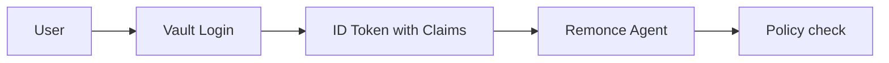

# HashiCorp Vault OIDC Configuration

This guide walks through configuring HashiCorp Vault as an OIDC Identity Provider for Remonce.

> [!TIP]
> A complete Terraform example is available in [`vault_setup.tf`](../../vault_setup.tf) at the project root.

## Overview

Vault can act as an OIDC provider, issuing JWTs that Remonce uses for authentication. The key challenge is correctly configuring **claim templates** so that user identity and group memberships are included in the ID Token.



## Prerequisites

- HashiCorp Vault 1.9 or later (the open-source edition is fine), acting as the OIDC provider
- Any Vault auth method for your users: userpass, LDAP, OIDC, and so on
- Terraform (recommended) or the Vault CLI, with admin access to Vault

Vault creates an identity entity for each user on their first login, whatever the auth method. Create entities ahead of time only if you want to put users in groups before they've logged in, as the local setup does.

> [!TIP]
> **Local development**: `vault_setup.tf` and the start scripts set all of this up with a dev-mode Vault and userpass users; see [GETTING_STARTED.md](../../GETTING_STARTED.md#2-start-the-identity-provider) and [DEVELOPMENT.md](../../DEVELOPMENT.md#vault-development-configuration).

---

## Step 1: Create Identity Groups

Groups become a claim policy can decide on. Add identity entities to groups:

```hcl
resource "vault_identity_group" "example_users" {
  name              = "example-users"
  type              = "internal"
  member_entity_ids = [vault_identity_entity.example_user.id]
}
```

---

## Step 2: Define OIDC Scopes (Claim Templates)

This is where most configuration issues occur. Vault uses **scope templates** to inject claims into the JWT.

### Groups Scope

```hcl
resource "vault_identity_oidc_scope" "groups" {
  name        = "groups"
  description = "Vault Groups Scope"
  template    = base64encode(<<EOF
{
  "groups": {{identity.entity.groups.names}}
}
EOF
  )
}
```

### User Profile Scope

```hcl
resource "vault_identity_oidc_scope" "user_profile" {
  name        = "user_profile"
  description = "Vault User Profile Scope"
  template    = base64encode(<<EOF
{
  "username": {{identity.entity.name}}
}
EOF
  )
}
```

> [!CAUTION]
> **Template Syntax**: Note that `{{identity.entity.groups.names}}` uses **double braces** and is **not** quoted. Vault injects the value as a JSON array. Quoting it will produce a malformed string.

### Available Template Variables

| Variable | Type | Description |
|----------|------|-------------|
| `{{identity.entity.id}}` | string | Entity UUID |
| `{{identity.entity.name}}` | string | Entity name |
| `{{identity.entity.groups.names}}` | array | Group names |
| `{{identity.entity.metadata}}` | object | Custom metadata |
| `{{identity.entity.aliases}}` | array | Login aliases |

---

## Step 3: Create the Token Key

Vault signs every ID token it issues with a key; remonce fetches the public half from the provider's `.well-known/keys` and checks every token against it. (This is Vault's key, not to be confused with the *signing client* in the next step.)

```hcl
resource "vault_identity_oidc_key" "remonce" {
  name             = "remonce"
  algorithm        = "RS256"
  rotation_period  = 604800  # 1 week; older keys stay published until their tokens expire
  verification_ttl = 86400
}
```

## Step 4: Create the Two OIDC Clients

remonce uses **two** clients, and the difference matters:

| Client | Used for | In `config.toml` |
|---|---|---|
| **Signing** (`remonce-signing`) | A fresh, re-authenticating login for every approval and revocation, with a one-time key bound through the `nonce` | `signing_client_id` |
| **Viewer** (`remonce-viewer`) | The ordinary login: the command catalog, files and execution logs, and identifying whoever executes a request | `viewer_client_id` |

Agents accept each client's tokens only where they belong, so a signing token carried inside a request can never be used to browse or execute, and a viewer token can never approve anything.

```hcl
resource "vault_identity_oidc_client" "remonce_signing" {
  name = "remonce-signing"
  key  = vault_identity_oidc_key.remonce.name

  redirect_uris = [
    # The signer on each user's machine
    "http://localhost:8080/oidc/callback",
    "http://127.0.0.1:8080/oidc/callback",
  ]
  assignments = [vault_identity_oidc_assignment.remonce_users.name]

  # Public client: no client secret; PKCE protects the code exchange.
  client_type = "public"

  # Approvals are valid from the login (`iat`), not until `exp`, so this
  # lifetime doesn't extend how long an approval stays usable.
  id_token_ttl     = 3600  # 1 hour
  access_token_ttl = 3600
}

resource "vault_identity_oidc_client" "remonce_viewer" {
  name          = "remonce-viewer"
  key           = vault_identity_oidc_key.remonce.name
  redirect_uris = vault_identity_oidc_client.remonce_signing.redirect_uris
  assignments   = [vault_identity_oidc_assignment.remonce_users.name]
  client_type   = "public"

  # Viewer tokens are bearer credentials: keep them short-lived.
  id_token_ttl     = 900  # 15 minutes
  access_token_ttl = 900
}

# Let both clients use the key. These are separate resources because each
# client also names the key; listing the clients on the key would be a cycle.
resource "vault_identity_oidc_key_allowed_client_id" "remonce_signing" {
  key_name          = vault_identity_oidc_key.remonce.name
  allowed_client_id = vault_identity_oidc_client.remonce_signing.client_id
}

resource "vault_identity_oidc_key_allowed_client_id" "remonce_viewer" {
  key_name          = vault_identity_oidc_key.remonce.name
  allowed_client_id = vault_identity_oidc_client.remonce_viewer.client_id
}
```

> [!IMPORTANT]
> **Redirect URIs**: list the signer's callback exactly as each signer is configured (`oidc.redirect_uri`); OIDC doesn't allow wildcards. The signer runs on each user's machine, so the loopback addresses cover the usual case.

> [!WARNING]
> **Use these clients only for remonce.** Every approval's ID token travels inside the request to later approvers, the executor and the agent. If another application accepted tokens for these clients, any of them could replay a token against it.

---

## Step 5: Create an OIDC Assignment

Assignments **bridge** entities and groups to the clients. Only assigned entities can log in.

```hcl
resource "vault_identity_oidc_assignment" "remonce_users" {
  name      = "remonce-users"
  group_ids = [vault_identity_group.example_users.id]
}
```

> [!TIP]
> **Different people per client**: create separate assignments if, say, only some people may approve (signing client) while more may browse (viewer client). Policy still decides what each person may do; this only decides who can log in at all.

---

## Step 6: Configure the OIDC Provider

Finally, create the provider that serves the OIDC endpoints, and allow both clients and the scopes from Step 2.

```hcl
resource "vault_identity_oidc_provider" "remonce" {
  name = "vaultprovider"

  allowed_client_ids = [
    vault_identity_oidc_client.remonce_signing.client_id,
    vault_identity_oidc_client.remonce_viewer.client_id,
  ]

  scopes_supported = [
    vault_identity_oidc_scope.groups.name,
    vault_identity_oidc_scope.user_profile.name,
  ]
}

output "oidc_provider_issuer_url" {
  value = vault_identity_oidc_provider.remonce.issuer
}

output "oidc_signing_client_id" {
  description = "remonce's signing_client_id"
  value       = vault_identity_oidc_client.remonce_signing.client_id
}

output "oidc_viewer_client_id" {
  description = "remonce's viewer_client_id"
  value       = vault_identity_oidc_client.remonce_viewer.client_id
}
```

---

## Remonce Configuration

After Vault is configured, put the outputs in your `config.toml`:

```toml
[oidc]
issuer_url        = "<oidc_provider_issuer_url>"   # e.g. https://vault.example.com/v1/identity/oidc/provider/vaultprovider
signing_client_id = "<oidc_signing_client_id>"
viewer_client_id  = "<oidc_viewer_client_id>"
redirect_uri      = "http://localhost:8080/oidc/callback"
```

Leave `signing_max_age` at its default of `1s`: Vault rejects `max_age=0` ("max_age must be greater than zero").

### Getting the Values

```bash
terraform output -raw oidc_provider_issuer_url
terraform output -raw oidc_signing_client_id
terraform output -raw oidc_viewer_client_id
```

---

## Verification

### 1. Check OIDC Discovery

```bash
curl https://vault.example.com/v1/identity/oidc/provider/vaultprovider/.well-known/openid-configuration
```

### 2. Verify Token Claims

After an approval, its ID token (inside the request file, under `approvals[].id_token`) should contain:

```json
{
  "iss": "https://vault.example.com/v1/identity/oidc/provider/vaultprovider",
  "sub": "<entity-id>",
  "aud": "<signing-client-id>",
  "iat": 1790460388,
  "auth_time": 1790460388,
  "nonce": "<sha256-of-ephemeral-public-key>",
  "groups": ["example-users"],
  "username": "example-user"
}
```

`aud` must be the bare client ID (not a list with other audiences), and `auth_time` must be present and close to `iat`. Vault issues `auth_time` when `max_age` is requested, and with `max_age=1` it sends the user back through the login page even if they have a Vault session.

---

## Troubleshooting

### Claims are missing from JWT

| Symptom | Cause | Fix |
|---------|-------|-----|
| No `groups` claim | Entity not in a group | Add entity to group |
| No custom claims at all | No entity alias | Create alias linking login to entity |
| `groups` is a string | Template uses quotes | Remove quotes around `{{...}}` |

### "Client not found" or "Unauthorized"

- Check `signing_client_id` and `viewer_client_id` in `config.toml` match the `terraform output` values exactly
- Ensure the entity is included in an assignment linked to the client

### Redirect URI mismatch

- Vault is strict about URIs. `localhost` ≠ `127.0.0.1`
- Add both variants to `redirect_uris` during development

---

## Security Best Practices

1. **Dedicated clients**: Never share the signing or viewer client with other applications, or use one client for both
2. **Short viewer token TTL**: Viewer tokens are bearer credentials for browsing and executing; keep their TTL short (5-15 minutes). The signing client's TTL doesn't affect how long an approval is usable
3. **Claim minimization**: Only request the scopes your policy needs
4. **HTTPS in Production**: Never use HTTP issuer URLs in production
5. **Restrict Assignments**: Only assign entities that should access Remonce
