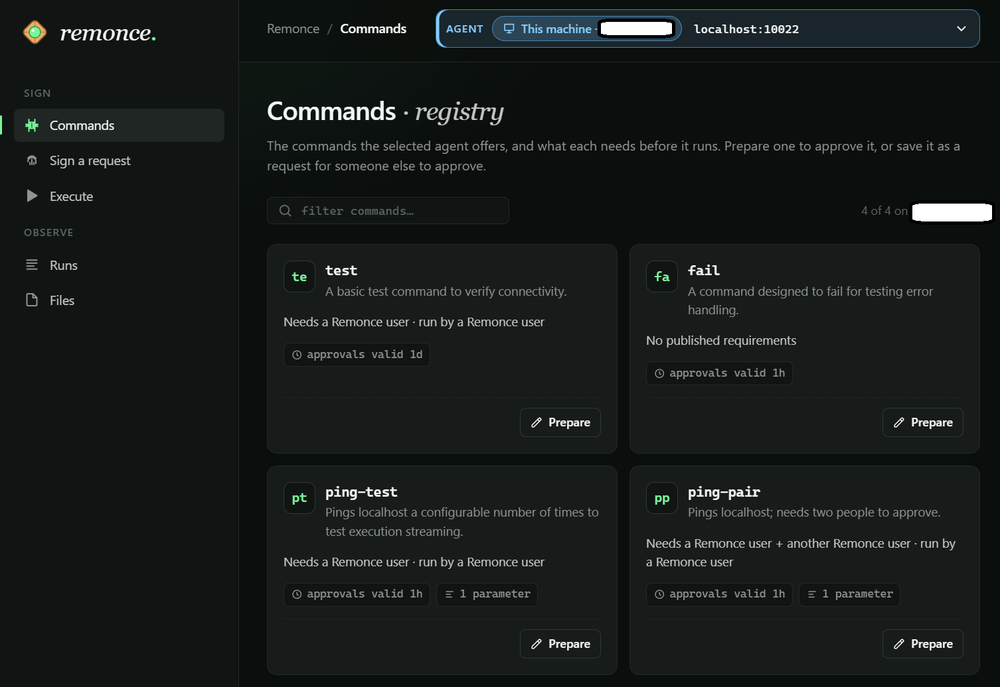

# remonce

***re**mote **mon**itor · **c**ommand **e**xecution*

remonce lets people run a fixed set of commands on a host, and read its logs, without giving them SSH. Each run has to be approved by the people your policy names, and the host records who approved it and who ran it. You approve on your own machine, so it still works when your desktop has no route to the host.

 

> [!WARNING]
> remonce is a proof of concept. It hasn't been hardened, closely reviewed or security audited. Use it at your own risk.



There is no remonce server or database to run. An agent on each host holds that host's commands and policy, and each person runs the signer on their own machine. The only shared services are your identity provider and a timestamp authority, and a public timestamp authority is used unless you say otherwise. You can start with the agent and the signer on one machine and add hosts later.

- [What it's for](#what-its-for)
- [How it works](#how-it-works)
- [Choosing a topology](#choosing-a-topology)
- [Setting up the servers](#setting-up-the-servers)
- [Approving a request](#approving-a-request)
- [Security](#security)
- [Trying it on one machine](#trying-it-on-one-machine)
- [Documentation](#documentation)

## What it's for

Checking a new VM's cloud-init output, restarting a service at 3am, or tailing an application log usually means a shell on the box, a VPN, or a standing credential. remonce is for doing those jobs without any of the three.

- A host offers a list of named commands with validated parameters. Nothing outside that list can run, and nothing runs through a shell.
- A host can also offer files, such as logs. They are streamed read-only.
- Who may approve a command and who may run it is policy, kept on the host. For most commands that is a few lines of JSON. Anything more is [Rego](https://www.openpolicyagent.org/docs/latest/policy-language/).
- A command can need more than one person, and two approvals have to come from two different people.
- A request is a file. You can email it, attach it to a ticket or carry it across a remote desktop session.

The owner of each machine decides what it offers and to whom. Nothing outside the machine can add a command to it or change its policy.

## How it works

```
  your workstation                                     target host
 ┌──────────────────────────┐                   ┌──────────────────────────┐
 │  remonce web  (signer)   │      HTTPS        │  remonce agent           │
 │  browser UI · approvals  │ ────────────────▶ │  catalog · run · stream  │
 └────────────┬─────────────┘                   └────────────┬─────────────┘
              │ fresh login per signature                    │ every decision
      your OIDC identity provider              Rego policy (built in, or OPA)
```

| Piece | Where it runs | What it does |
|---|---|---|
| Signer (`remonce web`) | Each person's own machine, on loopback only | Logs you in, shows an agent's commands, makes your approvals, sends requests to agents |
| Agent (`remonce agent`) | Each host | Offers commands and files, verifies requests, asks policy, runs the command, records it |
| Identity provider | Wherever yours is | Says who someone is. Any OpenID Connect provider: Vault, Okta, Keycloak and the like |
| Timestamp authority | Public by default (DigiCert) | Says when a signature was made |
| Policy | Inside the agent by default | Decides whether the approvals and the person running it are enough |
| Revocation service (`remonce revocation-service`) | Optional, one for the estate | Cancels a request on every agent at once |

A run goes like this:

1. You pick a command from a host's catalog. The catalog shows what the command needs: how many approvals, from whom, and who may run it.
2. You approve it. Each approval is its own login with a one-time key, and it is timestamped. If more people have to agree, you send them the request file and each adds their own approval.
3. Someone policy allows submits the approved request, logged in as themselves. The agent checks every signature, asks policy, runs the command once and streams the output back. The audit log records each approver and who ran it.

Anyone who approved a request can revoke it before it runs.

## Choosing a topology

remonce is one binary. Where each part runs, and what it trusts, is set in the `config.toml` next to it. This section goes through the arrangements that work today.

Two things are trusted in all of them: the identity provider, for who signed, and the timestamp authority, for when.

### One machine

The agent and the signer run side by side, and the signer talks to the agent on `localhost`. The UI labels it "This machine".

This is how the [tutorial](GETTING_STARTED.md) runs. It also suits a machine you look after yourself, where you want the approval step and the audit record but have nobody else to involve.

### Workstations and hosts

This is the usual arrangement, and the one in the diagram above. Each person runs the signer on their workstation. Each host runs an agent. The signer connects to agents over HTTPS.

The signer only talks to agents it has been told about: `agent_url` and `allowed_agent_urls` in its config, plus each person's own agents file. It refuses any other address, because it sends your login token and your approvals to whichever agent you pick.

What has to be able to reach what:

| From | To | For |
|---|---|---|
| Signer | Identity provider | Logins |
| Signer | Timestamp authority | A timestamp on each approval |
| Signer | Agent | The catalog, submitting requests, streaming output and files |
| Agent | Identity provider | Fetching the provider's signing keys |
| Agent | Revocation service, if you use one | A check before every run |
| Agent | OPA server, if you use one | Every decision |
| ACME certificate authority, if you use one | Agent, on port 443 or 80 | Issuing the agent's certificate |

Your browser only ever talks to the signer. The agent never connects to a workstation.

### Hosts your desktop can't reach

Plenty of hosts sit in networks a desktop has no route into. You get there over remote desktop, a jump host or a file drop. Approving doesn't need the host, so this works:

1. Get the request. Prepare it from somewhere that can reach the host's catalog, or take a request file someone sent you.
2. Approve it on your desktop. That needs the identity provider and the timestamp authority. Save the result as a file.
3. Carry the file in over RDP, SCP or a ticket attachment.
4. Run it from a machine inside, with a signer there or with `remonce submit`, logged in as yourself. That machine needs to reach the agent and the identity provider.

The file can't be changed on the way without breaking its signatures. It expires, and it runs once.

### A pipeline runs it

A person approves a request and a pipeline submits it later. The pipeline doesn't sign anything; policy sees it as the one running the request and can restrict it by its claims.

This only half works today. The pipeline needs an ID token from your identity provider for the viewer client, which rules out GitHub's or GitLab's own tokens. `remonce submit` always opens a browser, so the pipeline has to call the agent's `POST /execute` itself. [PRODUCTION_READINESS.md](PRODUCTION_READINESS.md) has the plan for fixing both.

### Options that apply to any of them

| Choice | Default | Alternative | What the alternative changes |
|---|---|---|---|
| Where policy is evaluated | Inside the agent, from `policy/` | An [OPA](https://www.openpolicyagent.org/) server (`opa_url`) | You get OPA's full builtin library, bundles and decision logs. The agent has to reach that server, and its answer is the decision, so the agent trusts it completely. |
| Revocation | Each agent keeps its own list | A central revocation service | One revocation covers every agent. An agent that can't reach the service refuses to run anything. |
| Agent certificate | Certificate files you supply | ACME (Let's Encrypt or another ACME authority) | No certificate files to manage. The authority has to reach the agent. ACME support is experimental. |
| Timestamp authority | DigiCert's public one | Your own (`[timestamp_authority]`) | Signers no longer need to reach the internet for timestamps. |
| Agent memory | In memory | A `state_dir` on disk | The agent still knows which requests ran or were revoked after a restart. Set this on any agent you leave running. |

None of these is imposed from outside. Each agent's own config says what that agent relies on, and an agent with no extras configured relies only on the identity provider and the timestamp authority.

## Setting up the servers

This is the short version. [CONFIGURATION.md](CONFIGURATION.md) has every setting, and [GETTING_STARTED.md](GETTING_STARTED.md) walks through a working setup on one machine.

Every mode reads `config.toml` from the directory it is started in, and ignores the sections it doesn't use. A misspelled setting stops startup.

### 1. Register two clients with your identity provider

remonce uses two OIDC clients, and they must be different:

- the signing client, which is logged into afresh for every approval and revocation;
- the viewer client, which is the ordinary login. It is also how the person running a request is identified.

Both need the redirect address the signer listens on, `http://localhost:8080/oidc/callback` by default.

Everything remonce asks of the provider is in the OpenID Connect spec: the authorization code flow with PKCE, a `nonce`, and `max_age` with `auth_time`. So any provider that implements the spec can be used, including Vault, Okta, Keycloak and the like. In practice that means it puts `iat` and `auth_time` in its ID tokens, issues each token to a single audience, and honours `max_age` (or `prompt=login`). The full list is under [IdP requirements](CONFIGURATION.md#idp-requirements).

Two details aren't configurable yet. Logins ask for the scopes `openid groups user_profile`; the spec says a provider should ignore scopes it doesn't know, though some refuse them. People are shown by their `username` claim, or by `sub` where there isn't one. Development is done against Vault, and [docs/idp/VAULT.md](docs/idp/VAULT.md) covers setting it up.

### 2. Put an agent on each host

Copy the binary, a `config.toml` and the `policy/` directory to the host, and run `remonce agent` from that directory under your service manager.

```toml
[oidc]
issuer_url = "https://idp.example.com/v1/identity/oidc/provider/main"
signing_client_id = "…"
viewer_client_id = "…"

[agent]
listen_address = "0.0.0.0:10022"
state_dir = "state"               # remember what ran and what was revoked across restarts
audit_log_path = "audit.jsonl"    # audit records also go to stdout

[agent.tls]
mode = "files"
chain = "certs/agent-fullchain.pem"
key = "certs/agent-key.pem"

[[commands]]
name = "restart-service"
description = "Restart one of this host's services"
opa_rule = "data.remonce.authz.decision"
executable = "systemctl"
args = ["restart", "{{service}}"]
env = { PATH = "/usr/bin:/bin" }  # commands start with an empty environment

[[commands.params]]
name = "service"
allowed = ["nginx", "postgres"]

[[files]]
path = "/var/log/nginx/*.log"
name = "nginx-logs"
description = "nginx access and error logs"
```

The agent only speaks HTTPS. With `mode = "files"` it picks up a renewed certificate without a restart. With `mode = "acme"` it gets and renews its own; see [the ACME section](CONFIGURATION.md#mode-acme-production) for the ports that needs.

A request only ever names a command. The executable and its arguments stay in this file, and a parameter value is checked against its rule before anything runs.

### 3. Say who may use each command

`policy/requirements.json` holds one entry per command:

```json
"restart-service": {
  "approvals": [ { "description": "an SRE", "any_of": [ { "op": "contains", "claim": "groups", "value": "sre" } ] } ],
  "executors":   { "description": "an SRE", "any_of": [ { "op": "contains", "claim": "groups", "value": "sre" } ] }
}
```

Each entry in `approvals` is a slot that needs its own person. `executors` says who may submit the approved request. The claims are whatever your identity provider puts in its tokens. The UI shows these entries next to each command, so people can see what a command needs before they ask for it.

A command with no entry is refused. Edits to anything in `policy/` take effect on the next request, with no restart.

The shipped `policy/authz.rego` also decides who may see the catalog, read files and watch runs, and who may revoke a request they didn't approve. It allows the tutorial's group, `webapp-users`, for all of these. Change that to a group of your own.

When a rule is about more than who, write it in Rego in the same file:

```rego
# Restarting postgres also needs someone from the DBA team among the approvers.
extra_denials contains "Restarting postgres needs a DBA's approval" if {
	input.action == "execute"
	input.command.command == "restart-service"
	input.command.params.service == "postgres"
	not dba_approved
}

dba_approved if {
	some approver in input.approvers
	"dba" in object.get(approver.claims, "groups", [])
}
```

### 4. Optional: a central revocation service

Without one, a revocation has to be sent to each agent the request could run on. With one, it is sent once.

```toml
[revocation_service]
listen_address = "0.0.0.0:10023"
persist_path = "revocations.jsonl"

[revocation_service.tls]
mode = "files"
chain = "certs/revocation-cert.pem"
key = "certs/revocation-key.pem"
```

Run `remonce revocation-service` with that, plus the same `[oidc]` section and policy as your agents, because it verifies revocations the way an agent does. Then point each agent at it:

```toml
[agent]
revocation_service_url = "https://revocations.example.com:10023"
```

An agent configured this way checks the service before every run and refuses to run if it can't reach it. There is no setting to make it carry on regardless.

### 5. Optional: an OPA server

Run OPA with the same `policy/` directory and set `opa_url` in the agent's config in place of `policy_dir`. The policy files work unchanged. An `http://` address anywhere but loopback needs `--insecure`, since whoever can alter OPA's answer decides what runs.

### 6. Give people the signer

Each person needs the binary and a `config.toml` on their own machine:

```toml
agent_url = "https://db01.example.com:10022"
allowed_agent_urls = ["https://web01.example.com:10022"]
# agent_ca_path = "certs/internal-ca.pem"   # if your agents use a private CA

[oidc]
issuer_url = "https://idp.example.com/v1/identity/oidc/provider/main"
signing_client_id = "…"
viewer_client_id = "…"
redirect_uri = "http://localhost:8080/oidc/callback"
```

They run `remonce web` and open [http://localhost:8080](http://localhost:8080). The signer refuses to listen on anything but loopback.

People can add agents of their own without touching that file, in `~/.config/remonce/agents.toml` (`%APPDATA%\remonce\agents.toml` on Windows). The [configuration guide](CONFIGURATION.md#your-own-agents-file) has the format.

## Approving a request

This part is for the person who has been asked to approve something. You need the signer running on your machine (`remonce web`) and [http://localhost:8080](http://localhost:8080) open in a browser. Log in when it asks.

### Someone sent you a request

1. Open **Sign a request**.
2. Drop the `.json` file you were sent onto the page, use **Open file…**, or paste its contents. The file is read in your browser and isn't uploaded anywhere.
3. Click **Review**. You'll see the command, its parameters, the machines it targets, who has approved it already and what it still needs. Under **Signed payload** is the exact text your approval covers.
4. Read it. Check that the command, the parameter values and the target machines are what you were told to expect. If the request came with an explanation, check that it matches.
5. Click **Approve**. You are sent to your identity provider to log in again, even if you logged in a minute ago. Every approval gets its own login.
6. You come back to a page that says **Approved**, with your name and the time.

What you do next depends on what the request still needs:

- If it needs more approvals, the page says which. Click **Save file** (or **Copy**) and send the result to the next person. They do the same steps you just did.
- If it has everything, you can click **Execute now** if you are allowed to run it, or save the file and hand it to whoever will.

What the request still needs is read from the agent selected in the bar at the top of the page. If the request is for a host your signer can't reach, the page can't show that, and the agent decides when the request is run.

### You are starting the request

1. On **Commands**, pick the agent in the bar at the top, then click the command.
2. Fill in the target machines and any parameters. The dialog shows what the command needs and the payload that will be signed.
3. Click **Approve** to add your own approval, which takes you through the login as above. If you aren't one of the people who can approve it, click **Save request** or **Copy request** and send it to someone who is.

### Running an approved request

Open **Execute**, give it the approved file the same way, and click **Review**, then **Execute**. It runs on the agent selected at the top, as you, and policy checks that you are allowed to run it. **Runs** shows the output as it arrives, along with who approved the request and who ran it.

### If you change your mind

Open the approved request on **Execute** and click **Revoke request**. You'll be asked to log in again. Anyone who approved a request can revoke it, as long as it hasn't run yet. Without a central revocation service the revocation applies to the agent you have selected, so repeat it for each agent the request targets.

### What your approval means

- It covers the payload you were shown and nothing else. Changing the command, a parameter or a target afterwards makes the signature invalid.
- It lasts an hour from your login unless the host's owner set a different time for that command. Every approval on a request must still be valid when it runs, so the first one sets the deadline.
- The request runs once on each agent it targets. Running it again means a new request and new approvals.
- Your approval is recorded on the host with your identity and the time.

### From a terminal

The same files work with the command line:

```sh
remonce approve --bundle remonce-restart-service-1a2b3c4d.request.json -o approved.json
remonce submit  --bundle approved.json --agent https://db01.example.com:10022
remonce revoke  --bundle approved.json --agent https://db01.example.com:10022
```

Each of these opens your browser for the login.

## Security

- Hosts hold no SSH keys or long-lived secrets for this. The agent accepts only signed, approved requests, over TLS.
- Every signature needs its own login, which must re-authenticate you, and a one-time key bound to the identity token. This is the [OpenPubkey](https://github.com/openpubkey/openpubkey) technique. Each signature also carries an RFC 3161 timestamp.
- Approvals expire, a request runs once, and two approvals must be two different people.
- With the shipped policy, a command that has no published requirements doesn't run.
- The person running a request is identified by an ordinary login token, which is a bearer credential. Keep that client's token lifetime short.

[SECURITY.md](SECURITY.md) has the threat model, [ARCHITECTURE.md](ARCHITECTURE.md) the signing protocol, and [PRODUCTION_READINESS.md](PRODUCTION_READINESS.md) the known gaps.

## Trying it on one machine

[GETTING_STARTED.md](GETTING_STARTED.md) takes you from nothing to your own command, a two-person rule, a Rego rule and reading a log, all locally with a development Vault as the identity provider. In outline:

1. Install Rust, Vault and Terraform, or use a release build in place of Rust.
2. Start Vault with its test users and clients: `./start_services.sh`, or `.\start_services.bat` on Windows.
3. Make a self-signed certificate for the agent and turn on the `[agent]` block in [config.toml](config.toml). The tutorial has the commands.
4. Run `cargo run -- agent` and `cargo run -- web` in two terminals.
5. Open [http://localhost:8080](http://localhost:8080) and log in as `webapp`. A second user, `webapp2`, lets you try `ping-pair`, which needs two approvals.

## Documentation

- [Getting started](GETTING_STARTED.md): the step-by-step tutorial.
- [Configuration](CONFIGURATION.md): every setting, requirement documents, the CLI and revocation.
- [Use cases](USECASES.md): solo VM checks, CI pipelines, NOC handoff, cross-team access, two-person rules.
- [Architecture](ARCHITECTURE.md): the signing protocol and the design decisions behind it.
- [Security model](SECURITY.md): the verification chain and the threat model.
- [Production readiness](PRODUCTION_READINESS.md): what is done and what isn't.
- [Alternatives](alternatives.md): how this compares with JEA, SSH and SSM.
- [Vault as the identity provider](docs/idp/VAULT.md).
- [Developing remonce](DEVELOPMENT.md).
- Proposals, not implemented: [live approval](docs/proposals/LIVE_APPROVAL.md) and [AI agents acting for their users](docs/proposals/AAUTH.md).

## License

MIT.
